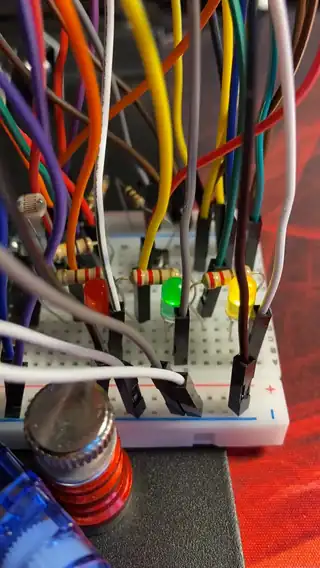

# Модуль 6.1: три світлодіоди на задачах FreeRTOS

Домашнє завдання курсу Embedded Basic: домашка 2.3, але через `xTaskCreatePinnedToCore`.
Плата ESP32-S3-WROOM-1-N16R8, PlatformIO, Arduino.



Відео в повній якості: [demo.mp4](demo.mp4)

## Схема

```
GPIO18 -> 220 Ом -> LED1 -> GND   кожні 200 мс
GPIO17 -> 220 Ом -> LED2 -> GND   кожні 500 мс
GPIO16 -> 220 Ом -> LED3 -> GND   кожні 1000 мс
```

## Що робить

- Кожен світлодіод перемикає окрема задача FreeRTOS, зі своїм інтервалом.
- Раз на 10 с окрема задача друкує в Serial, скільки разів перемкнувся кожен світлодіод.
- `loop()` не потрібен: задача `loop` видаляє себе через `vTaskDelete(nullptr)`.

## Як зроблено

- Одна функція `blinkTask` на три задачі. Яким світлодіодом керувати, задача отримує через параметр: адресу елемента глобального масиву `leds`.
- Масив глобальний, бо задачі працюють весь час, і адреси, які вони отримали, мають лишатися дійсними.
- У `setup()` цикл `for (auto &led : leds)` з `&`: так у задачу йде адреса самого елемента масиву, а не тимчасової копії.
- Затримка `vTaskDelayUntil`, а не `vTaskDelay`: період рахується від попереднього пробудження, тому час роботи всередині циклу не додається до періоду.
- Поки задачі сплять, вони не займають ядро.
- Лічильник перемикань змінює лише задача свого світлодіода, а задача звіту його тільки читає, тому м'ютекс не потрібен.

## Запуск

```
pio run -t upload -t monitor
```

## Результат

```
[10090 мс] перемикань за 10 с: GPIO18=50 GPIO17=20 GPIO16=10
[20090 мс] перемикань за 10 с: GPIO18=50 GPIO17=20 GPIO16=10
[30090 мс] перемикань за 10 с: GPIO18=50 GPIO17=20 GPIO16=10
[40090 мс] перемикань за 10 с: GPIO18=50 GPIO17=20 GPIO16=10
```

10 000 / 200 = 50, 10 000 / 500 = 20, 10 000 / 1000 = 10. Те саме, що в домашці 2.3 на `millis()`.

## Розмір

RAM 18 884 байти (5,8 %), Flash 265 041 байт (4,0 %).
